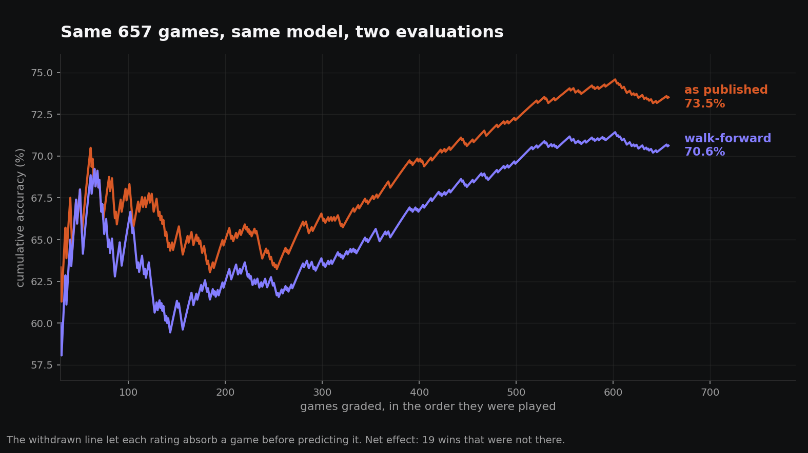

# Second Bounce

An NBA prediction engine that keeps a public receipt. Every pick is written down
before tip-off, graded after the final, and never recomputed. The predictions are the
product; the log is how you can tell whether they're any good.

- Live picks: https://atr777.github.io/nba-predictions/
- Every pick as a CSV: https://atr777.github.io/nba-predictions/ledger.csv
- Newsletter: https://secondbounce.substack.com

## The record

**2026-27, picks locked before tip-off: 69.1% across 188 games** (through Nov 16),
Brier score 0.2046. Each row in `ledger.csv` carries the time it was logged, and the
site repo commits the file whenever it changes, so you can check a pick against
GitHub's history instead of taking our word for it. (The ledger file started on Nov 17;
earlier picks are in the history of the page itself.)

**2025-26, walk-forward audit: 70.6% across 657 games.** The tracker originally
reported 73.5%. It was grading each game with ratings that had already absorbed that
game's result, so the model was partly remembering instead of predicting. We rebuilt
the season in strict time order (predict, then record, then update) and published the
lower number. That replay is honest, but it was rebuilt after the fact, which is why
2026-27 is the first season reported as pre-registered.

The two seasons were measured different ways and land in the same place, with an
identical Brier score. That's the best evidence so far that the audit was right.



**What that record is worth.** It's slightly behind Vegas closing lines on both
accuracy and Brier, and a bare "higher rating wins" rule ties it on the same games.
So this isn't a market-beating model and isn't presented as one. What it does well is
say how sure it is: in the 2025-26 audit, picks made at 80 to 90 percent confidence
won 79.6 percent of the time. The full story is in
[How We Caught Our Own Model Cheating](docs/growth/posts/2026-07-29-how-we-caught-our-own-model-cheating.md).

## Rules

1. Predictions are logged before games start and never recomputed.
2. No model change ships without a before/after walk-forward on two full seasons,
   checking accuracy and Brier ([`validate_config_2seasons.py`](scripts/validate_config_2seasons.py)).
3. Every number we publish is registered in [`config/metrics.yaml`](config/metrics.yaml)
   with its definition and sample, and [`validate_metrics.py`](scripts/validate_metrics.py)
   recomputes it from source. If reality moves, the check fails.
4. No betting content.

Rule 3 exists because prose can't tell when it's gone stale. It has caught the
project's own notes quoting four-month-old figures, and, while this README was being
rewritten, a metric definition claiming the 2025-26 picks were logged before tip-off.
They weren't; it was corrected.

## How a pick gets made

A VPS runs the pipeline at 7am, 11am, 2pm, 6pm and 11pm Eastern. Each run pulls
finished games from the NBA stats API, with ESPN as an independent fallback, and
rebuilds team ratings from every game since 2000. The rating is an Elo variant:
K of 20, 60 points of home advantage, a margin-of-victory multiplier, a back-to-back
penalty, and 45 percent carry-over between seasons. All of it is read from
[`config/settings.yaml`](config/settings.yaml), and the same function serves the
tracker and the public ratings, so they can't disagree.

[`track_predictions_pregame.py`](scripts/track_predictions_pregame.py) then grades any
finished games and locks a prediction for each game that hasn't started. A game that
is already live gets skipped, not back-filled. Last, the site is rebuilt and pushed.

Player ratings (box plus/minus fed into a player-level Elo) power the site's player
rankings and the newsletter. They don't enter the win probabilities, and we've
checked: shuffling every player rating changes no prediction.

## What didn't work

Most of the research ended in "no". Each write-up has the test and the numbers.

- **Probability recalibration** (Platt and isotonic) made Brier worse out of sample,
  because the model sharpened as the season went on. [Write-up](docs/research/2026-07-08-home-advantage-and-recalibration.md)
- **Tuning home advantage**: no value beat 60 in a paired test. Same write-up.
- **Rookie priors by draft position**: the fitted curve generalized and changed
  nothing, because a rookie mostly replaces a replacement-level player. [Write-up](docs/research/2026-07-09-rookie-priors.md)
- **Roster-change adjustment**: a real Brier gain on its own, which disappeared once
  season carry-over was tuned. Disabled in the engine. [Write-up](docs/research/2026-07-09-roster-delta.md),
  [follow-up](docs/research/2026-07-09-coaching-and-season-reversion.md)

## Incidents

**Opening night, 2026-10-20.** The site showed "0 games today" and the tracker locked
nothing. Two bugs. The NBA's live scoreboard had started refusing requests, and the
ESPN fallback only ran when the primary came back empty, not when it failed. And the
tracker looked for tonight's games in a file that only ever receives finished ones, so
it had found nothing since it shipped in July (the offseason hid it). Both were fixed
within the hour. One of the three opening-night games was locked before tip; the other
two had already started and are not in the record.

## Repo map

| Path | What it does |
|---|---|
| `src/engines/team_elo_engine.py` | Team ratings and win probabilities |
| `scripts/track_predictions_pregame.py` | Locks pre-game picks, grades finals |
| `scripts/audit_tracking_leakage.py` | The walk-forward replay behind the 2025-26 number |
| `scripts/validate_metrics.py` + `config/metrics.yaml` | Published numbers and their recomputation |
| `scripts/daily_update.py`, `scripts/run_daily_update.sh` | The scheduled pipeline |
| `scripts/export_github_pages.py` | Builds the site and `ledger.csv` |
| `docs/research/` | Dated write-ups of each model decision |

`app.py` and the modules it imports are an older local dashboard, including a betting
module from before rule 4. None of it is on the live path.

## Running it

```bash
pip install -r requirements.txt
python scripts/daily_update.py            # ingest results, rebuild ratings, track picks
python scripts/export_github_pages.py     # build pages/index.html and pages/ledger.csv
python scripts/validate_metrics.py        # do the published numbers still match?
```

Game data (`data/raw/`) is gitignored and rebuilt by the pipeline.

## Who

Aaron runs Second Bounce: the model decisions, the editorial calls, and the publish
button. Most of the code was written with Claude Code working as the engineering
agent, inside the rules above. The commit history shows which commits.
